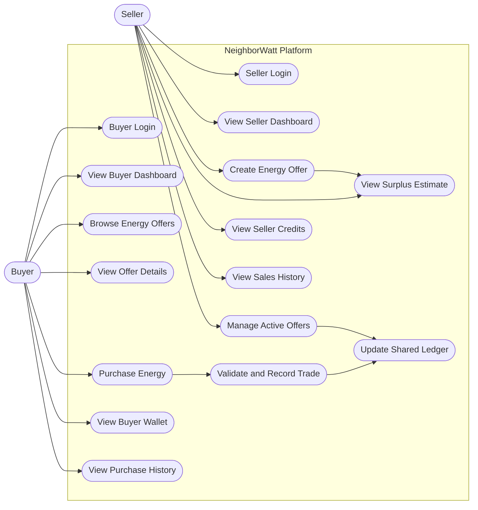
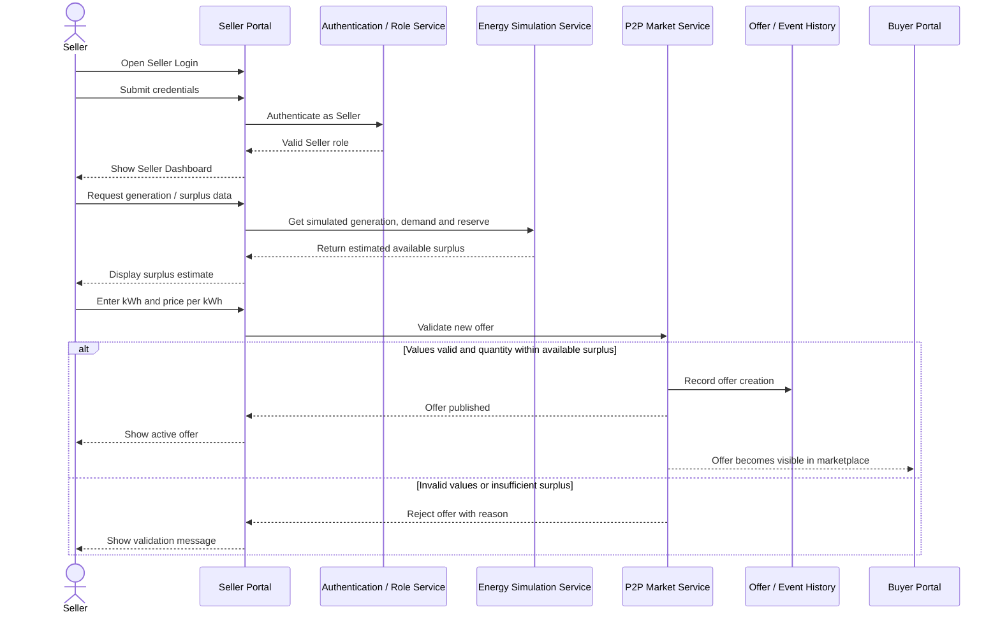
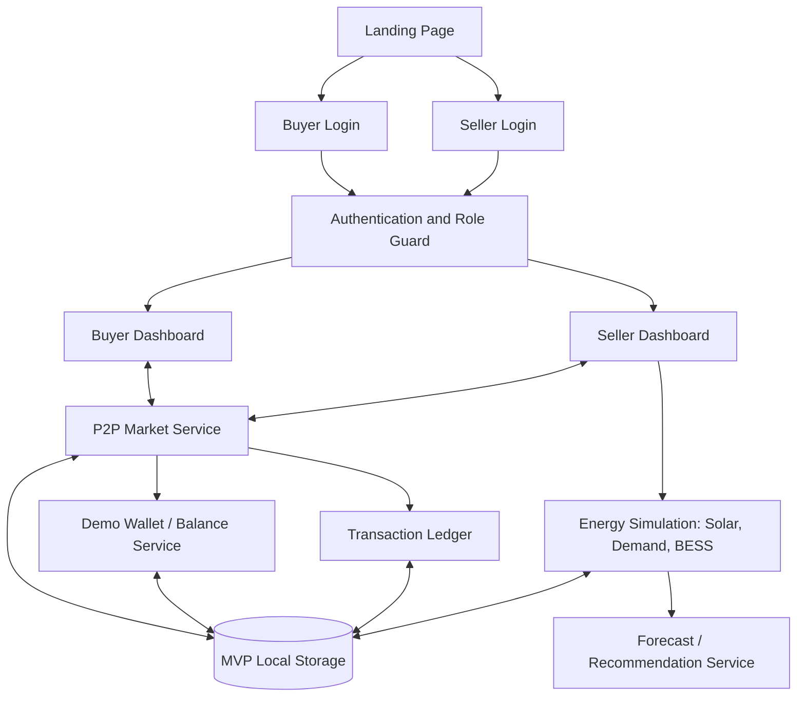

# NeighborWatt — Buyer/Seller Workflow, Requirements & Diagrams

> **Project:** NeighborWatt — Decentralised Peer-to-Peer Solar Mesh  
> **Theme:** Renewable Energy Last-Mile Access  
> **Document purpose:** Simple project explanation, role-based workflows, functional and non-functional requirements, and system diagrams.

---

## 1. Project in Simple Terms

**NeighborWatt is a community energy-sharing platform.** It helps households in a village share locally available renewable electricity instead of treating every household as an isolated consumer.

Some households may generate more solar electricity than they currently need. These households are **Sellers** (also called *prosumers*). Other households may need additional energy. These households are **Buyers** (also called *consumers*). NeighborWatt provides a marketplace where a Seller can list surplus energy and a Buyer can find and request an available offer.

The wider concept also includes:

- **Solar panels:** produce electricity locally.
- **BESS (Battery Energy Storage System):** stores surplus energy and can help cover demand when solar generation is low.
- **P2P market and ledger:** records energy offers and transactions between households.
- **AI-assisted forecasting:** estimates future demand and recommends when to charge/discharge the battery or shift flexible loads.
- **Feature-phone/USSD access:** a future access option for people who do not use smartphones.
- **Community ownership:** the energy system is intended to be operated for local community benefit.

### Simple example

Household A has 5 solar panels and 1 kWh of available surplus. Household B needs 1 kWh. The Seller lists the surplus on NeighborWatt, the Buyer purchases the available offer, and the application records the transaction and updates the demo balances.

**Important scope note:** In the current academic MVP, energy readings, AI recommendations, wallet credits and transaction settlement can be simulated. A successful demo transaction does **not** mean electricity has physically moved between homes or that real money has been transferred.

---

## 2. Main Objective

To demonstrate a practical, easy-to-understand community energy marketplace that connects households with available surplus energy to households that need energy, while showing how solar generation, battery storage and AI-assisted balancing can support the network.

## 3. Users and Separate Login Requirements

The MVP must provide **two distinct login experiences** and role-specific dashboards.

### 3.1 Buyer Login

Suggested route: `/buyer/login`

A Buyer is a household that wants to purchase energy from an available local offer.

**Buyer dashboard features:**

- View current demo wallet balance.
- Browse available energy offers.
- Filter offers by price, available kWh or seller.
- View offer details: Seller, available quantity, price per kWh and offer status.
- Select an offer and request a quantity.
- See a cost summary before confirming.
- Confirm or cancel a purchase.
- View purchase confirmation and transaction history.
- View purchased energy and remaining demo balance.
- Receive notifications about transaction status.

### 3.2 Seller Login

Suggested route: `/seller/login`

A Seller is a household that has solar generation or another approved local supply source and wants to offer verified surplus energy.

**Seller dashboard features:**

- View demo solar generation, household demand and estimated surplus.
- View battery state of charge and a configured reserve threshold, where simulated BESS data is available.
- Create an energy offer by specifying available kWh and price per kWh.
- Validate that the quantity is positive and does not exceed the surplus available in the simulation.
- Publish, edit or cancel an offer that has not been fully purchased.
- View active, partially filled and completed offers.
- View sales, credited demo balance and transaction history.
- Receive a notification when a Buyer purchases the Seller's listed energy.

### 3.3 Login and Access Rules

- Buyer and Seller must have separate login pages and separate dashboards.
- The application may use a shared authentication service internally, but it must validate the role on every protected route.
- A Buyer session must not open Seller-only pages or perform Seller-only actions.
- A Seller session must not open Buyer-only pages or perform Buyer-only actions unless the account is explicitly authorised for both roles.
- Provide demo accounts or a clearly labelled demo sign-in option for the academic presentation.
- A production version should use secure server-side authentication and role-based authorisation; frontend-only role checks are not sufficient for production.

---

## 4. Core System Workflow

```text
Solar generation / energy availability
                 |
                 v
        Seller checks surplus
                 |
                 v
       Seller creates an offer
                 |
                 v
       NeighborWatt P2P Market
                 |
                 v
         Buyer browses offers
                 |
                 v
         Buyer selects quantity
                 |
                 v
       Validate offer and balance
                 |
                 v
       Confirm purchase transaction
                 |
          +------+------+
          |             |
          v             v
   Buyer balance    Seller credit
   is debited       is updated
          |             |
          +------+------+
                 v
      Ledger/history is updated
                 |
                 v
       Both users see confirmation
```

BESS and AI forecasting support the wider energy-management concept. For the MVP, these may provide simulated readings and recommendations alongside the Buyer/Seller marketplace.

---

## 5. Functional Requirements

Functional requirements describe what the system must do.

### 5.1 Authentication and Role Management

| ID | Requirement | Priority |
|---|---|---|
| FR-01 | The system shall provide a separate Buyer login page. | Must |
| FR-02 | The system shall provide a separate Seller login page. | Must |
| FR-03 | The system shall validate a user's credentials before opening a protected dashboard. | Must |
| FR-04 | The system shall enforce role-based access to Buyer and Seller features. | Must |
| FR-05 | The system shall provide logout and return the user to the appropriate login page. | Must |

### 5.2 Buyer Functions

| ID | Requirement | Priority |
|---|---|---|
| FR-06 | The Buyer shall be able to view the current demo wallet balance. | Must |
| FR-07 | The Buyer shall be able to browse active energy offers. | Must |
| FR-08 | The Buyer shall be able to view offer quantity, price per kWh and Seller information. | Must |
| FR-09 | The Buyer shall be able to select an offer and enter a requested quantity. | Must |
| FR-10 | The system shall calculate the estimated cost before purchase confirmation. | Must |
| FR-11 | The system shall prevent a purchase if the offer quantity or Buyer balance is insufficient. | Must |
| FR-12 | After confirmation, the system shall update the demo wallet, offer quantity, transaction ledger and Buyer history together. | Must |
| FR-13 | The Buyer shall be able to view past and current transaction statuses. | Should |
| FR-14 | The Buyer shall receive success or failure feedback after an attempted purchase. | Must |

### 5.3 Seller Functions

| ID | Requirement | Priority |
|---|---|---|
| FR-15 | The Seller shall be able to view simulated generation, demand and available surplus. | Must |
| FR-16 | The Seller shall be able to create an offer with quantity in kWh and price per kWh. | Must |
| FR-17 | The system shall reject zero, negative or invalid offer quantities and prices. | Must |
| FR-18 | The system shall prevent a Seller from listing more energy than the simulated available surplus. | Must |
| FR-19 | The Seller shall be able to view active, partially filled and completed offers. | Must |
| FR-20 | The Seller shall be able to edit or cancel an offer while the remaining quantity is still available. | Should |
| FR-21 | When an offer is purchased, the system shall reduce the available offer quantity and update the Seller's demo credit and history. | Must |
| FR-22 | The Seller shall be able to view sales and transaction history. | Should |

### 5.4 Marketplace and Ledger

| ID | Requirement | Priority |
|---|---|---|
| FR-23 | The marketplace shall show only active offers with a positive remaining quantity. | Must |
| FR-24 | The system shall record each completed demo trade with a unique transaction ID, timestamp, Seller, Buyer, energy quantity, price and status. | Must |
| FR-25 | The system shall prevent the same offer quantity from being sold twice. | Must |
| FR-26 | The system shall show a clear transaction result to both Buyer and Seller. | Must |
| FR-27 | Demo balances and transactions shall persist across page refreshes in the MVP. | Should |

### 5.5 Energy, BESS and AI Simulation

| ID | Requirement | Priority |
|---|---|---|
| FR-28 | The dashboard shall display simulated solar generation and village demand. | Must |
| FR-29 | The dashboard shall display simulated BESS state of charge and charge/discharge status. | Must |
| FR-30 | The simulation shall model charging when generation exceeds demand and discharging when demand exceeds generation, subject to reserve rules. | Should |
| FR-31 | The forecast view shall show simulated demand/solar forecasts and recommendations. | Should |
| FR-32 | AI recommendations shall be labelled as simulated in the MVP unless a real model is connected. | Must |

### 5.6 General Interaction

| ID | Requirement | Priority |
|---|---|---|
| FR-33 | The user shall be able to navigate from the landing page to the correct role login. | Must |
| FR-34 | Forms shall display validation errors near invalid fields. | Must |
| FR-35 | The application shall provide loading, success, empty and error states where relevant. | Should |
| FR-36 | The application shall provide reset-demo functionality for repeated presentations. | Should |

---

## 6. Non-Functional Requirements

Non-functional requirements describe how well and how safely the system should operate.

| ID | Category | Requirement / target |
|---|---|---|
| NFR-01 | Usability | A first-time user should be able to understand whether they are in the Buyer or Seller portal without confusion. |
| NFR-02 | Performance | Main dashboard and market views should load within about 3 seconds on a typical laptop and reasonable connection, excluding unusual network conditions. |
| NFR-03 | Responsiveness | The application must work on desktop, tablet and mobile layouts without unintended horizontal overflow. |
| NFR-04 | Security | Protected routes and actions must enforce roles; production credentials must never be stored as plain text. |
| NFR-05 | Data integrity | A purchase must update offer quantity, Buyer debit, Seller credit and transaction record consistently. |
| NFR-06 | Reliability | Invalid purchases and failed validations must not partially update wallet or offer state. |
| NFR-07 | Persistence | MVP demo data should survive refresh using localStorage or another clearly identified storage mechanism. |
| NFR-08 | Accessibility | Use semantic HTML, keyboard-operable controls, visible focus states, labels and adequate colour contrast. |
| NFR-09 | Maintainability | Keep authentication, marketplace logic, simulation, wallet and ledger logic in separate modules/services. |
| NFR-10 | Scalability | The architecture should permit migration from local demo storage to an API and database without rewriting the UI. |
| NFR-11 | Compatibility | Support current versions of Chrome, Edge and Firefox; test Safari if available. |
| NFR-12 | Transparency | Clearly label simulated energy readings, wallets, AI recommendations and settlement. |
| NFR-13 | Auditability | Every simulated completed trade should have a record that can be inspected by Buyer and Seller. |
| NFR-14 | Motion/performance | Animation must not block core flows and should respect `prefers-reduced-motion`. |
| NFR-15 | Privacy | Collect only information required for the demo; do not expose one user's private account details to another user. |

---

## 7. UML-Style Use-Case Diagram

The system has two primary actors: **Buyer** and **Seller**, each entering through a distinct login flow. They share the central marketplace and transaction ledger, but their allowed actions differ.



### Use-case descriptions

| Use case | Actor | Expected result |
|---|---|---|
| Buyer Login | Buyer | Buyer is authenticated and taken to the Buyer dashboard. |
| Browse Offers | Buyer | Active offers and available quantities are displayed. |
| Purchase Energy | Buyer | A valid purchase is confirmed and the ledger/balances are updated. |
| View Purchase History | Buyer | Buyer sees previous trades and statuses. |
| Seller Login | Seller | Seller is authenticated and taken to the Seller dashboard. |
| View Surplus Estimate | Seller | Seller sees estimated energy available to offer. |
| Create Energy Offer | Seller | A valid offer becomes visible in the marketplace. |
| Manage Active Offers | Seller | Seller can inspect, edit or cancel eligible offers. |
| View Sales History | Seller | Seller sees completed sales and demo credits. |
| Validate and Record Trade | System | Offer availability and Buyer balance are checked before a trade is committed. |

---

## 8. Sequence Diagram — Buyer Purchase Workflow

```mermaid
sequenceDiagram
    actor Buyer
    participant BP as Buyer Portal
    participant Auth as Authentication / Role Service
    participant Market as P2P Market Service
    participant Wallet as Demo Wallet Service
    participant Ledger as Transaction Ledger
    participant Seller as Seller Portal

    Buyer->>BP: Open Buyer Login
    Buyer->>BP: Submit credentials
    BP->>Auth: Authenticate as Buyer
    Auth-->>BP: Valid Buyer role
    BP-->>Buyer: Show Buyer Dashboard

    Buyer->>BP: Browse active offers
    BP->>Market: Request available offers
    Market-->>BP: Return active offers
    BP-->>Buyer: Display offers and prices

    Buyer->>BP: Select offer and quantity
    BP->>Market: Check remaining quantity and price
    Market-->>BP: Return offer details and cost
    BP-->>Buyer: Show purchase summary
    Buyer->>BP: Confirm purchase

    BP->>Wallet: Check Buyer demo balance
    Wallet-->>BP: Balance sufficient / insufficient

    alt Balance sufficient and offer available
        BP->>Market: Commit purchase request
        Market->>Ledger: Record trade and unique transaction ID
        Market->>Wallet: Debit Buyer and credit Seller demo balance
        Market->>Market: Reduce offer quantity / update status
        Market-->>BP: Purchase successful
        BP-->>Buyer: Show confirmation and transaction ID
        Market-->>Seller: Notify Seller of sale
    else Balance or quantity insufficient
        BP-->>Buyer: Show error; do not change balances or offer
    end
```

### Buyer workflow in plain English

1. The Buyer opens the **Buyer Login** page and signs in.
2. The Buyer browses available offers and selects one.
3. The application shows the amount of energy requested and the estimated total cost.
4. After confirmation, the system checks the Buyer balance and whether the offer still has enough energy.
5. If both checks pass, the transaction is recorded and the Buyer debit, Seller credit and remaining offer quantity are updated together.
6. Both parties can see the transaction in their history. If validation fails, no trade-related values should change.

---

## 9. Sequence Diagram — Seller Listing Workflow



### Seller workflow in plain English

1. The Seller opens the **Seller Login** page and signs in.
2. The Seller dashboard shows simulated generation, demand, BESS reserve and estimated surplus.
3. The Seller enters the quantity to sell and price per kWh.
4. The system validates the values and ensures the quantity does not exceed the available surplus estimate.
5. A valid offer is published and appears in the Buyer marketplace; invalid offers are rejected with a helpful message.
6. When a Buyer completes a purchase, the offer quantity, Seller credit and transaction history are updated.

---

## 10. Recommended Application Architecture



**Implementation note:** For a quick academic MVP, a frontend simulation with centralised state and localStorage can demonstrate the workflows. For a real deployment, move authentication, role checks, offer validation, wallet/accounting and transaction commits to a trusted backend and database. A production transaction should use an atomic database operation so a Buyer cannot purchase the same remaining quantity twice.

---

## 11. Suggested Database / Data Objects

| Entity | Important fields |
|---|---|
| User | `id`, `name`, `email`, `role` (`buyer` or `seller`), `status` |
| Wallet | `userId`, `demoBalance`, `updatedAt` |
| EnergyOffer | `id`, `sellerId`, `availableKWh`, `pricePerKWh`, `status`, `createdAt` |
| EnergyTransaction | `id`, `offerId`, `buyerId`, `sellerId`, `quantityKWh`, `unitPrice`, `total`, `status`, `createdAt` |
| EnergyReading | `villageId`, `generationKW`, `demandKW`, `batterySOC`, `timestamp` |
| Recommendation | `id`, `title`, `reason`, `priority`, `status`, `createdAt` |

For the MVP, these can be TypeScript objects stored in localStorage. This is not a substitute for a secure production database.

---

## 12. Acceptance Criteria for the Demonstration

The MVP should be considered ready for a basic demonstration when:

- [ ] Buyer Login and Seller Login are visibly separate.
- [ ] Buyer credentials/role lead to the Buyer dashboard, not Seller features.
- [ ] Seller credentials/role lead to the Seller dashboard, not Buyer-only features.
- [ ] Buyer can browse at least three seeded energy offers.
- [ ] Buyer can complete a purchase when balance and quantity are sufficient.
- [ ] The Buyer balance decreases by the purchase total.
- [ ] The Seller demo credit increases by the same total.
- [ ] The available offer quantity decreases by the energy purchased.
- [ ] The transaction is recorded once and visible in the relevant histories.
- [ ] The system rejects purchases with insufficient balance or unavailable quantity without partial updates.
- [ ] Seller can publish a valid energy offer.
- [ ] Seller cannot publish a negative quantity, invalid price or quantity above the simulated surplus.
- [ ] The offer appears in the Buyer marketplace after publication.
- [ ] Both dashboards update after a trade.
- [ ] Solar, demand and BESS metrics can be demonstrated.
- [ ] The interface works on desktop and mobile widths.
- [ ] The demo clearly labels simulated wallet, energy and forecasting features.

---

## 13. Limitations and Future Enhancements

### Included in the quick MVP

- Separate Buyer and Seller login experiences
- Role-specific dashboard navigation
- Simulated solar, demand and BESS data
- Seller offer creation
- Buyer offer browsing and demo purchases
- Demo balances and transaction history
- AI-style deterministic recommendations
- Responsive interface and local persistence

### Not automatically included without additional implementation

- Real smart-meter data
- Real physical electricity delivery or dispatch
- Actual payments or regulated energy settlement
- Production authentication and secure account recovery
- Hyperledger or other live distributed ledger
- A trained AI forecasting model
- A live mobile-network USSD gateway
- Regulatory approval for community electricity trading

The prototype should be presented honestly as a **functional software simulation of the NeighborWatt workflow**, not as a live electricity trading network.

---

## 14. One-Sentence Presentation Explanation

**NeighborWatt is a community energy-sharing platform with separate Buyer and Seller portals: Sellers list their available solar-energy surplus, Buyers purchase available offers, and the system records the transaction while using simulated solar, battery and AI features to demonstrate how a village energy mesh could operate.**
