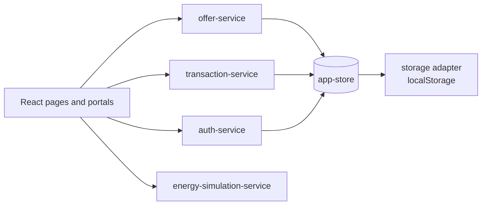
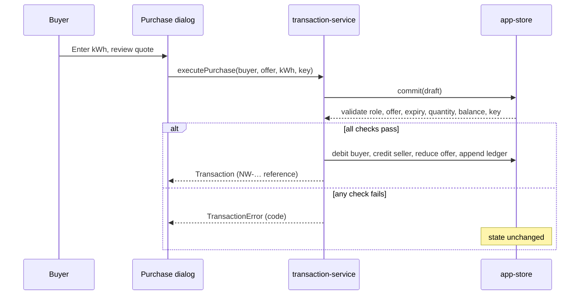
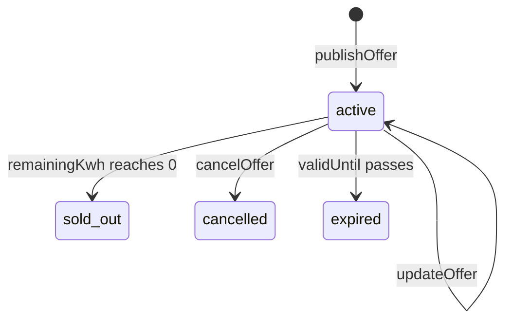

# NeighborWatt

Peer-to-peer solar energy sharing for a village microgrid. Sellers with rooftop surplus publish offers; buyers purchase kWh from them. This is an academic MVP: all data is simulated and all money is demo credit.

## Quick start

```bash
npm install
npm run dev          # http://localhost:5173
npm run build        # type-check + production bundle
npx vitest run       # unit tests
```

### Demo accounts

Password for every seeded account: `NeighborWatt#2026`

| Portal | Email |
| --- | --- |
| Buyer | `buyer@neighborwatt.demo` |
| Seller | `seller@neighborwatt.demo` |
| Other sellers | `arun@neighborwatt.demo`, `lalita@neighborwatt.demo` |

Buyer and seller sign-in are separate. A session for one portal cannot open the other.

## Features

- **Two portals:** Buyer (wallet, marketplace, purchase ledger) and Seller (offers, surplus, settlement ledger), each with its own login and dashboard.
- **Marketplace:** Browse active offers, buy a quantity through a quote-and-confirm dialog.
- **Transaction service:** The only code that changes balances, offer quantities, or the ledger. Each purchase is atomic, carries a checksum, and is idempotent.
- **Energy views:** Energy flow, BESS storage, demand forecast, and simulated generation.
- **Community impact** and **USSD** channel simulation.

## Architecture



Every write goes through `commit()` in `app-store`. It works on a copy of state and swaps it in only after validation passes, so a rejected request changes nothing.

## Purchase flow



Rejection codes: `NOT_BUYER`, `OFFER_NOT_FOUND`, `OFFER_NOT_ACTIVE`, `EXCEEDS_REMAINING`, `INVALID_QUANTITY`, `INSUFFICIENT_BALANCE`, `SELF_PURCHASE`, `DUPLICATE_SUBMISSION`.

## Offer lifecycle



## Project layout

```
src/
  auth/            session context and role guard
  components/      ui primitives, layout, marketplace, ledger, energy
  data/seed.ts     demo accounts and offers (hashed passwords)
  lib/             formatting, checksum, crypto, class helpers
  pages/           landing, auth, buyer, seller, marketplace, energy, forecast, ussd
  services/        auth, offers, transactions, simulation, forecast, validation
  stores/          app-store with commit(), constants
  test/            vitest suites
```

## Testing

- `src/test/transactions.test.ts` covers quoting, money movement, sold-out handling, insufficient balance (state unchanged), over-quantity rejection, role gating, idempotency, and unknown offers.
- Browser checks were run against the production build with Playwright: login for both portals, cross-portal blocking, marketplace listing, a full purchase through the dialog, and ledger visibility.

## Production notes

This is a demo. Before real use:

- Replace `transaction-service` with a server endpoint that runs the same checks in a single database transaction.
- Replace the localStorage adapter with a real database and a managed identity provider.
- Connect the energy simulation to real metering data.
- Payment is simulated as demo credit. No real money moves.
